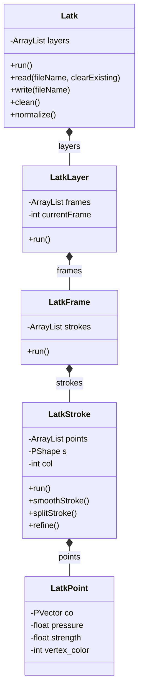

# Architecture of latkProcessing

The `latkProcessing` library provides a way to read, write, and manipulate 3D drawing data within [Processing](https://processing.org/). It is primarily designed around the **Lightning Artist (LATK)** format, but also provides utilities for importing data from other popular 3D sketching tools like **Tilt Brush** and **Quill**.

## Core Data Model

The data architecture is heavily influenced by the Grease Pencil structure, providing a hierarchical approach to storing drawing data over time. The core classes correspond to the levels of this hierarchy:

*   **`Latk`**: The top-level container for a sequence of 3D drawings. It manages the animation timeline (FPS, playing state) and holds a list of layers. It can read/write data from/to `.json` or compressed `.zip` files.
*   **`LatkLayer`**: A single layer in the timeline. It contains a list of frames.
*   **`LatkFrame`**: A single frame in a specific layer. It represents the drawing at a given point in time and contains a list of strokes.
*   **`LatkStroke`**: A continuous line drawn by the user. It contains a list of points, a color, and is internally represented as a Processing `PShape` for rendering. It also provides operations to smooth or refine the stroke.
*   **`LatkPoint`**: A single vertex within a stroke, consisting of a 3D coordinate (`PVector`), pressure, strength, and vertex color.

### Relationship Diagram

## Supported Formats

### LATK (Lightning Artist)
The main class `Latk.java` handles reading and writing the LATK format. It can process both raw `.json` LATK files and compressed zip archives (where the `.json` is wrapped inside).

The write logic outputs a JSON structure representing:
`{ grease_pencil: [ { layers: [ { frames: [ { strokes: [ { points: [ ... ] } ] } ] } ] } ] }`

### Tilt Brush Importer
*   **`TiltLoader`**: Unzips `.sketch` files (which are actually zip archives) and parses the `data.sketch` binary payload and `metadata.json`. It converts the binary data into an array of `TiltStroke` objects.
*   **`TiltStroke`**: A lightweight container storing an array of 3D `PVector` positions, along with brush size and brush color.

### Quill Importer
*   **`QuillLoader`**: Similar to the TiltLoader, it reads `.qbin` (and `Quill.json`) files either from a `.zip` archive or directly from the file system. It traverses the scene graph nodes and extracts stroke drawing data.
*   **`QuillStroke`**: A lightweight container storing stroke data specifically from Quill. In addition to 3D positions, it stores varying widths and colors per point.

## Rendering and Processing Flow

1.  **Initialization**: Typically, a `Latk` object is initialized with a reference to the main `PApplet` (`this` in Processing) and optionally a file path to load.
2.  **Drawing Update Loop**: In the Processing `draw()` loop, calling `latk.run()` (or `latk.run(PGraphics)`) triggers a cascade down the hierarchy:
    *   `Latk` checks if enough time has passed based on the `fps` to advance to the next frame.
    *   It then calls `run()` on each `LatkLayer`.
    *   `LatkLayer` calls `run()` on its currently active `LatkFrame`.
    *   `LatkFrame` calls `run()` on all its `LatkStroke`s.
    *   `LatkStroke` draws its internally cached `PShape`.
3.  **Data Operations**: `Latk` offers methods to modify the data before rendering:
    *   `clean()`: Removes duplicate points that are too close to each other (`cleanMinLength`), removes very short strokes, and cleans up strokes with too few points.
    *   `normalize()`: Rescales all points across all frames and layers to fit within a normalized 0 to 1 bounding box coordinate space.
    *   Stroke refinement: Individual `LatkStroke`s can be split (interpolating new points halfway between existing ones) and smoothed (averaging point positions with their neighbors) via `smoothStroke()`, `splitStroke()`, and `refine()`.

## Packaging and Build
The `src/build` directory contains scripts (like `build.command` and `build.bat`) likely used for compiling the Java source files and assembling the `.jar` package that acts as a standard Processing library plugin.
